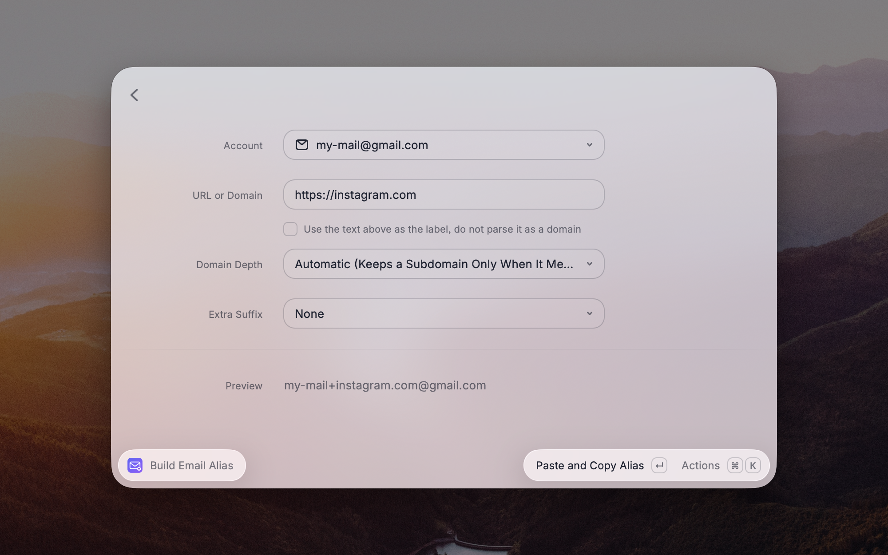
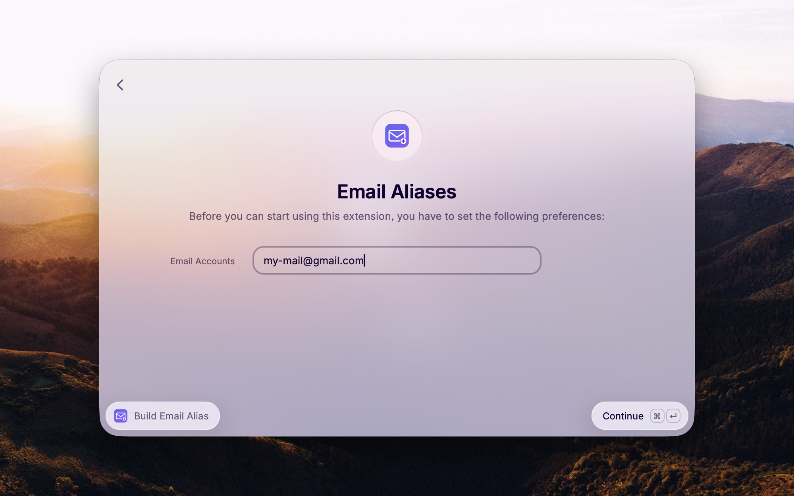

<div align="center">


# Email Subaddresses & Aliases

**A fresh email address for every website, right from the sign-up form.**<br>
A [Raycast](https://raycast.com) extension that turns the site you are on into a plus-address or catch-all alias
and pastes it for you.

[](https://github.com/jnbp/raycast-email-subaddresses/releases/latest)


[](LICENSE)

[**Download the installer**](https://github.com/jnbp/raycast-email-subaddresses/releases/latest/download/install-email-subaddresses.zip) · [How it works](#how-it-works) · [Setup](#setup) · [FAQ](#faq)

<br>



</div>

---

## Why

Most mail providers deliver `me+anything@gmail.com` straight to `me@gmail.com`. That is called **subaddressing**
([RFC 5233](https://www.rfc-editor.org/rfc/rfc5233)), and it is the easiest privacy tool you already have: give
every service its own address, and when spam arrives you know exactly who leaked it – and can filter it away.

Nobody types those addresses by hand, though. This extension does it for you: on `account.bvg.de` one hotkey
pastes `me+bvg.de@gmail.com` into the email field.

## How it works

```
you are on            account.bvg.de
your account          me@gmail.com
                      ───────────────────────
the alias             me+bvg.de@gmail.com      ← copied and pasted for you
```

With a catch-all domain (`@mydomain.com`), the alias becomes the whole local part: `bvg.de@mydomain.com`.

## Features

<table>
<tr>
<td width="50%" valign="top">

### ⚡ One hotkey, done
**Generate Email Alias** reads the active browser tab, builds the alias and pastes it into the field you are
typing in. No window opens. An optional argument takes your own label (`newsletter`) or another site.

</td>
<td width="50%" valign="top">

### 🧩 Build it by hand
**Build Email Alias** is a form with an account picker, a live preview and per-run overrides for domain depth and
suffix. It also works without a browser – just type the domain.

</td>
</tr>
<tr>
<td width="50%" valign="top">

### 🌐 Smart about domains
Uses the Public Suffix List, so `amazon.co.uk` never collapses to `co.uk`. **Automatic** depth drops login and SSO
noise like `login.microsoftonline.com` but keeps what identifies a service, like `nas.example.com` or
`mycompany.atlassian.net`.

</td>
<td width="50%" valign="top">

### 🔐 Your rules
Several accounts, plus addressing or catch-all, custom separators, templates with tokens, and optional date or
random suffixes so an alias cannot be guessed from the domain alone.

</td>
</tr>
</table>

## Setup

The only required preference is **Email Accounts**, a comma-separated list. Each entry can be:

| Entry | Result on `bvg.de` |
| --- | --- |
| `me@gmail.com` | `me+bvg.de@gmail.com` |
| `Work: me@company.com` | `me+bvg.de@company.com`, shown as "Work" in the picker |
| `Catch-All: @mydomain.com` | `bvg.de@mydomain.com` |

> [!TIP]
> **The first entry is your default account.** Generate Email Alias always uses it, because it runs without a window
> and is meant for a hotkey. Build Email Alias preselects it and lets you switch for that run. To change the
> default, move the account you want to the front of the list.

<details>
<summary><b>Domain depth in detail</b></summary>

<br>

**Automatic** (the default) looks at the hostname and decides for itself:

| Hostname | Alias | Why |
| --- | --- | --- |
| `account.bvg.de` | `bvg.de` | `account` says nothing about who they are |
| `login.microsoftonline.com` | `microsoftonline.com` | single sign-on noise |
| `store.steampowered.com` | `steampowered.com` | `store` is a section, not an identity |
| `auth.services.adobe.com` | `adobe.com` | more than one level in front means infrastructure |
| `idp-a83f2c91.okta.com` | `okta.com` | generated hostname |
| `nas.example.com` | `nas.example.com` | a real service on your own domain |
| `mycompany.atlassian.net` | `mycompany.atlassian.net` | the tenant is the identity |
| `myproject.vercel.app` | `myproject.vercel.app` | same on multi-tenant platforms |

Or choose a fixed depth – levels are counted on top of the public suffix:

| Setting | `eu.shop.example.co.uk` becomes |
| --- | --- |
| Domain + suffix | `example.co.uk` |
| One level more | `shop.example.co.uk` |
| Two levels more | `eu.shop.example.co.uk` |
| Full hostname | `eu.shop.example.co.uk` |
| Name only | `example` |

</details>

<details>
<summary><b>Templates and tokens</b></summary>

<br>

The alias template and the catch-all template accept these tokens:

`{user}` `{sep}` `{label}` `{suffix}` `{alias}` `{domain}` `{host}` `{date}` `{random}`

`{alias}` is the label plus the optional suffix. Examples:

- `{user}{sep}{alias}@{domain}` → `me+bvg.de@gmail.com` (default)
- `{user}-{label}-{date}@{domain}` → `me-bvg.de-2609@gmail.com`
- `{alias}@{domain}` → `bvg.de@mydomain.com` (default for catch-all accounts)

</details>

<details>
<summary><b>Supported browsers</b></summary>

<br>

The current tab is read through AppleScript, with nothing extra to install: Arc, Dia, Chrome, Chromium, Brave,
Edge, Vivaldi, Opera, Safari, Orion, Sidekick, Comet, Helium, Shift, Wavebox, Whale and Yandex, including beta and
canary builds. For Firefox and Zen, the extension falls back to the
[Raycast browser extension](https://www.raycast.com/browser-extension). If neither works, use
**Build Email Alias** and type the domain.

</details>

## Installation

### Option 1 – Installer (recommended)

1. Download **[install-email-subaddresses.zip](https://github.com/jnbp/raycast-email-subaddresses/releases/latest/download/install-email-subaddresses.zip)** and double-click it to unzip.
2. Double-click **install-email-subaddresses.command**.

The installer checks for Raycast and Node.js, downloads the latest release and imports the extension. **Run the
same file again to update** – it always fetches the newest release and keeps your preferences.

> [!NOTE]
> Downloaded scripts are not signed by Apple, so macOS may block the first double-click. Open **System Settings ›
> Privacy & Security** and click **Open Anyway**, or start it from Terminal, which is never blocked:
>
> ```bash
> bash ~/Downloads/install-email-subaddresses.command
> ```

### Option 2 – From source

```bash
git clone https://github.com/jnbp/raycast-email-subaddresses.git
cd raycast-email-subaddresses
npm install && npm run dev
```

**Requirements:** macOS, [Raycast](https://raycast.com) and Node.js 22 or newer.

<div align="center">

<br><sub>On first run, Raycast asks for your email accounts.</sub>
</div>

## FAQ

<details>
<summary><b>Does my mail provider support plus addresses?</b></summary>

Gmail, Outlook.com, Proton Mail, Fastmail and most self-hosted servers do. Some providers use a hyphen instead of
a plus sign – change the **Separator** preference. With your own domain, a catch-all address works everywhere.
</details>

<details>
<summary><b>A website rejects the plus sign.</b></summary>

A few sign-up forms do. Use a catch-all account for those sites: the alias then has no plus sign at all
(`bvg.de@mydomain.com`).
</details>

<details>
<summary><b>Does it send any data anywhere?</b></summary>

No. Everything happens locally. No alias, URL or address ever leaves your machine.
</details>

## License

[MIT](LICENSE) © jnbp
